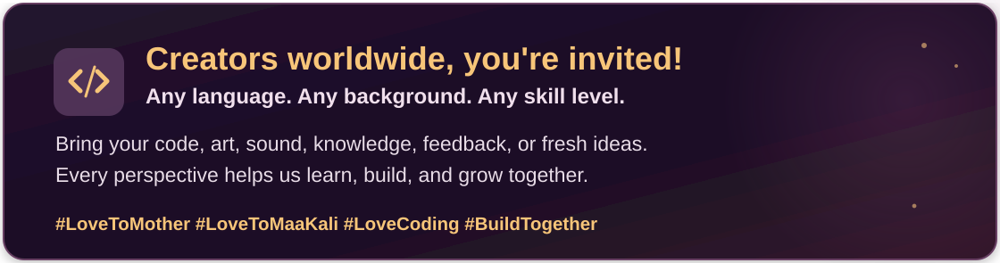

# Python Art Gallery — Maa Kali

**A 31-second devotional animation built frame by frame with Python.**  
*A Mitratics creative-coding project.*

> [!TIP]
> **▶ Play the Maa Kali animation — start here!**  
> Install dependencies once with `python -m pip install -r requirements.txt`, then run **`python play.py`** from the project folder (Windows, macOS, or Linux).  
> The `play` launcher **renders the complete 31-second Python animation, adds one optional *local* soundtrack from `audio/`, and opens the finished MP4** in your default video player. No song? It plays the silent animation automatically.  
> **Git Bash / macOS / Linux:** `bash play` · **Windows Command Prompt:** `play` · **Windows PowerShell:** `.\play.cmd`  
> **Quick preview:** `python play.py --preview` · **Silent only:** `python play.py --silent` · **No player:** `python play.py --no-open`  
> This command uses your own Python installation and project files; it does **not** depend on the original creator’s laptop paths. Bring your own soundtrack only if you have permission to use it.

[Watch the current silent preview](exports/Maa_Kali_Radiant_31s_Python.mp4) · [Explore the renderer](render_radiant_31s.py) · [See the tests](tests/test_radiant_movie.py)

**Film:** 432 × 768 (portrait) · 20 FPS · 620 frames · H.264 MP4  
**Status:** Working development version. Local audio mixing is implemented; the official release and public licensing are still being prepared.

> **How it is made:** Python draws the opening M, Mahadev, the ending, smoke, sparks, lighting, and transitions. The approved **16-frame Maa Kali GIF** in `assets/` provides the central character reveal. Python blends that artwork into the scene and encodes the complete video. The renderer does **not** use a finished MP4 as input. This is Python-produced animation, **not a fully code-drawn Kali character**.

## How the animation works

```text
Frame number (0–619)
        ↓
render_radiant_31s.py → render_frame(frame_number)
        ↓
Scene 1 / Scene 2 / Scene 3
        ↓
Pillow draws and combines the visual layers → one RGB image
        ↓
imageio-ffmpeg encodes RGB frames → output/*.mp4
```

| Time | Scene | Python work |
|---|---|---|
| **0.0–7.6s** | Golden M | Draw curved paths, glowing rings, smoke and drifting particles in `code_art/scene1.py`. |
| **7.6–25.3s** | Mahadev and Maa Kali | Animate the approved GIF, blend adjacent frames, draw Mahadev in front, and add mist and embers in `render_radiant_31s.py` and `code_art/eyes_shiva.py`. |
| **25.3–31.0s** | Greeting | Draw the M, “Happy Kali Puja”, “Coming Soon”, and background effects in `code_art/scene3.py`. |

**The main idea:** A video is a sequence of images. At 20 FPS, Python creates 20 images for every second. `render_frame(index)` chooses the scene; Pillow creates the image; FFmpeg joins the images into a playable video.

## Libraries and where they are used

Only **two external Python packages** are required by the current video renderer and playback launcher. See [`requirements.txt`](requirements.txt).

| Package | Official link | Used for | Main APIs in this project |
|---|---|---|---|
| **Pillow** (`PIL`) | [Docs](https://pillow.readthedocs.io/en/stable/) · [Source](https://github.com/python-pillow/Pillow) | Draw shapes and text, read GIF frames, blur glow, combine layers | `Image`, `ImageDraw`, `ImageFilter`, `ImageFont`, `Image.blend`, `alpha_composite` |
| **imageio-ffmpeg** | [Docs and source](https://github.com/imageio/imageio-ffmpeg) · [PyPI](https://pypi.org/project/imageio-ffmpeg/) | Encode frames into an H.264 MP4 with FFmpeg | `write_frames()` for video; `get_ffmpeg_exe()` for audio mixing |

**Built into Python (no extra install):** [`math`](https://docs.python.org/3/library/math.html) for curves and movement, [`random`](https://docs.python.org/3/library/random.html) for repeatable particle patterns, [`pathlib`](https://docs.python.org/3/library/pathlib.html) for file paths, [`argparse`](https://docs.python.org/3/library/argparse.html) for render options, [`functools.lru_cache`](https://docs.python.org/3/library/functools.html) to reuse Shiva drawings, and [`unittest`](https://docs.python.org/3/library/unittest.html) for tests.

**Encoding:** `imageio-ffmpeg` provides FFmpeg for the supported installation. The renderer outputs H.264 (`libx264`) with `yuv420p` pixel format for broad playback support. [FFmpeg documentation](https://ffmpeg.org/documentation.html).

## Code map — where should I make changes?

| File | What it does | Change it when you want to… |
|---|---|---|
| [`play.py`](play.py) and [`play`](play) / [`play.cmd`](play.cmd) | One-command render, optional local music, and automatic desktop playback on Windows/macOS/Linux | Run and watch the video; change the playback workflow |
| [`render_radiant_31s.py`](render_radiant_31s.py) | Main entry point; frame timing, scene selection, GIF interpolation, compositing and MP4 export | Adjust timing, transitions, canvas size, frame rate or output |
| [`add_music.py`](add_music.py) | Mixes a local soundtrack into an existing silent video using FFmpeg | Choose song start, music volume, fade-in/out or audio input |
| [`code_art/scene1.py`](code_art/scene1.py) | Draws the M with Bézier paths, orbital rings, glow and embers | Improve the opening logo or particles |
| [`code_art/eyes_shiva.py`](code_art/eyes_shiva.py) | Draws dark atmosphere, glowing eyes, smoke and foreground Mahadev | Change the reveal and scene atmosphere |
| [`code_art/shiva_approved.py`](code_art/shiva_approved.py) | Draws Mahadev’s pose, hair and fire/smoke details | Improve the character drawing |
| [`code_art/scene3.py`](code_art/scene3.py) | Draws the ending logo, greeting and “Coming Soon” | Change text, typography or ending effects |
| [`assets/maa_kali_radiant_reveal.gif`](assets/maa_kali_radiant_reveal.gif) | Approved Kali character frames | Update the character animation asset |
| [`tests/test_radiant_movie.py`](tests/test_radiant_movie.py) | Checks timing, frame size, animation changes and scene boundaries | Add automated quality checks |
| [`.github/workflows/python-tests.yml`](.github/workflows/python-tests.yml) | Runs tests on GitHub after pushes and pull requests | Extend continuous integration (CI) |

**Key functions to look for:** `scene1.render_frame()`, `load_reference_frames()`, `asset_position()`, `middle_frame()`, `shiva_layer()`, `scene3.render_frame()`, and `render_video()`.

The core timing values are easy to find:

```python
# render_radiant_31s.py
W, H = 432, 768
FPS = 20
OPENING, MIDDLE, ENDING = 152, 354, 114
FRAMES = OPENING + MIDDLE + ENDING  # 620 frames / 20 FPS = 31 seconds
```

**Visual techniques:** Bézier curves draw smooth paths; a changing frame index creates motion; RGBA layers allow transparency; `GaussianBlur` makes light glow; `Image.blend()` makes smooth transitions. In Scene 2, `CUES` controls when the 16 GIF frames appear across 17.7 seconds, and cached Shiva layers avoid repeated heavy drawing.

## Run the project

**Recommended:** Run `python play.py` to render and watch the complete animation in one step. Or use `bash play` in Git Bash/macOS/Linux, `play` in Windows Command Prompt, or `.\play.cmd` in PowerShell. The optional soundtrack is local and not distributed. `--preview` renders a 4-second **silent** demo; `--no-open` builds without launching a player.

Install **Python 3.11+** and the project dependencies (a virtual environment is recommended):

```bash
python -m pip install -r requirements.txt
python -m unittest discover -s tests -v
```

Render a single frame, a short preview, or the full silent movie:

```bash
python render_radiant_31s.py --still 355
python render_radiant_31s.py --preview
python render_radiant_31s.py
```

The full render is written to `output/Maa_Kali_Radiant_31s_Python.mp4`. Generated files in `output/` are ignored by Git. The `exports/` video is the saved development baseline. On a system with Bash, `bash run.sh test`, `bash run.sh preview`, and `bash run.sh full` are shortcuts. If `python` is unavailable, use your system's Python command or virtual-environment interpreter.

## Audio — mix a soundtrack with Python

The animation renderer creates a **silent MP4** first. The separate, working [`add_music.py`](add_music.py) script uses Python's [`subprocess`](https://docs.python.org/3/library/subprocess.html) and [`imageio-ffmpeg`](https://github.com/imageio/imageio-ffmpeg) to add music without redrawing frames or changing the original video. FFmpeg copies the existing H.264 video and encodes the chosen soundtrack as AAC.

**Run from the project root:**

```bash
python render_radiant_31s.py     # Render the 31-second silent video
python add_music.py             # Mix the first 31 seconds of a local song
```

Put **one** music file (for example, `audio/background_music.mp3`) inside `audio/`. The script finds it automatically; supported formats include MP3, WAV, M4A, AAC, FLAC, and OGG. The music file is **not included in this repository**.

| Setting | Default | Customize |
|---|---|---|
| Song starting point | `0` seconds | `--start 40` starts at 40 seconds |
| Music volume | `0.72` (72%) | `--volume 0.6` |
| Fade-in | `1.5` seconds | `--fade-in 2` |
| Fade-out | `2` seconds | `--fade-out 3` |
| Output | `output/Maa_Kali_31s_Audio_Review.mp4` | `--output path/to/file.mp4` |

Example with custom timing:

```bash
python add_music.py --start 40 --volume 0.6 --fade-in 2 --fade-out 3
```

**How the audio code works:** `choose_audio()` finds the local soundtrack; `argparse` reads the options; an FFmpeg audio filter trims or pads sound to 31 seconds, adjusts volume and applies fades; `subprocess.run()` executes FFmpeg. The original MP3 and silent MP4 remain unchanged. See [`README_AUDIO_ADDON.md`](README_AUDIO_ADDON.md) for the short audio guide.

**Publishing note:** The `audio/` music files and `output/` review renders are ignored by Git. Only publish an audio-containing video if you have permission to distribute its soundtrack. The original silent development video is available in [`exports/`](exports/).

## Contribute and develop



**Make it yours:** Pick a scene or feature from the **Code map** above, improve it, and run `--preview` and the tests. When contributions open, share your work through a pull request. **All ideas are welcome; changes to `main` are reviewed before merging.**

**Quick Git:** `git status` → `git add .` → `git commit -m "Describe change"` → `git push`. [GitHub Actions](.github/workflows/python-tests.yml) checks the tests, but does not yet render the full movie in CI.

**Versions and rights:** Git history records development; completed editions will use GitHub Releases. Public code licensing, artwork permissions, and contribution rules are still being prepared. The video, GIF, Mitratics branding, and third-party music are not automatically covered by a future code license.

---

**Made with Python · A Mitratics project · Built for creative developers.**
